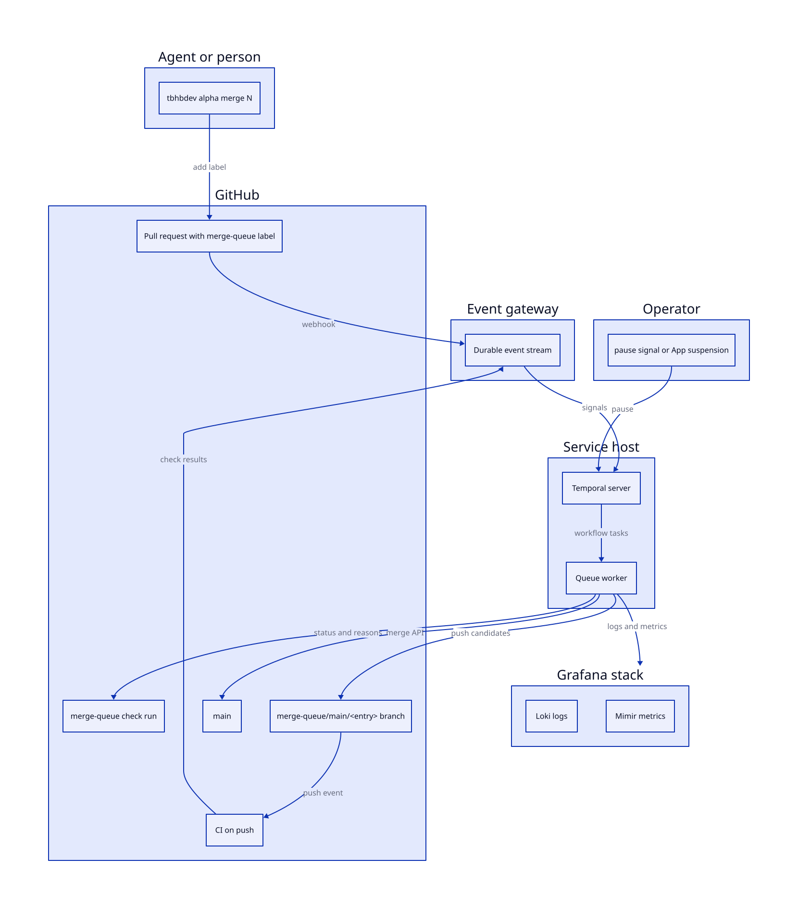

<!-- SPDX-License-Identifier: Apache-2.0 -->
<!-- Copyright Tony Burns -->

# An in-house merge queue for every repository

| Status | Owner | Updated | Needs from the operator |
| --- | --- | --- | --- |
| Draft | Merge queue maintainer | 2026-11-24 | 0 open decisions in [decisions.md](decisions.md) |

## Summary

GitHub's merge queue runs on tbhb-dev's public repositories and nowhere else. On private ones such as ops and agent-config, the API refuses the rule, and the Team plan won't change that without a paid upgrade. Where the queue does run, a pass in tools takes about 1400 seconds, and nobody can easily see why.

This design builds the merge queue as Temporal workflows on hosts tbhb-dev owns, fed by the event gateway, as the operator chose for the review and merge queue. It tests each pull request on top of the projected main, then merges with merge commits through a dedicated GitHub App.

The recommendation is to start serial on ops and enforce the queue with a required check that only its App can set. For the operator, a new pause and stop path works without the queue's help.

## Proposal

When this is built, these parts exist:

- **Queue workflows.** One long-running Temporal workflow per repository keeps that repository's queue. A child workflow tests and merges each group (new). Temporal's durable history holds queue state, so a crash resumes where it stopped (existing decision: Temporal orchestrates the review and merge queue).
- **A queue worker.** One Go process in a new public repository, tbhb-dev/merge-queue, runs the workflows' activities: Git, GitHub, and telemetry calls (new). It runs as a container under a Unix service account on a service host, never on an agent Mac (existing rule). The merge queue maintainer role builds and runs it.
- **A Temporal server.** Self-hosted on an owned host, as the operator decided (existing decision; nothing deployed yet). Until the ops role deploys a production server, the queue runs on Temporal's single-binary server with its SQLite file (new).
- **A dedicated GitHub App.** The worker pushes candidate branches, sets its own check run, and merges pull requests with this App's tokens (new, D1). Its key stays in 1Password, and the worker reads it through Connect, as `tbhbdev alpha gh-app` does today (existing).
- **Event intake.** The event gateway's planned Temporal target signals the queue workflows. Until it exists, the worker reads the gateway's read API with a saved cursor and sends the signals itself (existing API). A reconcile read every 15 minutes catches anything lost (existing ruling).
- **Candidate branches and CI.** For each entry, the worker writes the chain of merge commits on main's tip up to that entry and pushes it to `merge-queue/main/<entry>`. Each repository's CI runs on that push (new).
- **A `merge-queue` check run on every queued pull request.** It shows position, group, the step running now, and the reason for any wait (new). A main ruleset requires it, pinned to the queue App, which makes the queue the one path to main (new, D2).
- **The agent path.** `tbhbdev alpha merge N` adds the `merge-queue` label in a queue repository instead of merging. A new `tbhbdev alpha merge-queue status N` answers why a pull request is stuck (new). Agents keep `alpha merge` as their one merge path (existing decision).
- **Operator controls and telemetry.** Pause, resume, and stop work per repository and for all of them. Logs go to Loki and metrics to Mimir, with a Grafana dashboard. Temporal's own web UI shows every workflow (new).

This design takes over the merge half of the automated review and merge queues design, its appendix G. Where they disagree, this design, the merge-commit record, and the Temporal decision win (see [appendix B](B-alternatives.md#the-earlier-review-and-merge-queues-design)).

## How it works

### A pull request's path

1. **Enqueue.** An agent runs `tbhbdev alpha merge N`, or anyone with triage access adds the `merge-queue` label. The gateway passes the labeled event on, and the repository's queue workflow gets a signal.
2. **Admit.** The workflow checks what GitHub enforces at merge time, plus what tbhb-dev adds:
   - an approval covers the exact head
   - every check at the head is green, except the queue's own `merge-queue` check
   - no review thread is open, and the branch merges cleanly
   - the title and trailer paragraph pass `alpha merge`'s message rules
   - the base is main, or a stacked parent already in the queue

   A failure leaves the label in place and sets the check run to `action_required` with the reason.
3. **Order.** The workflow orders admitted entries by priority, then enqueue time. Up to N entries merge together as one group, as in GitHub ([appendix C](C-github-parity.md)).
4. **Build candidates.** In a private bare mirror, the worker runs `git merge-tree --write-tree` for main's tip and each head in order. It writes one merge commit per entry, with the message `alpha merge` builds plus a `Merged-by` trailer. Each entry's chain goes to its own branch.
5. **Skip what's proven.** When a candidate's tree equals a tree that already passed CI, the workflow reuses that result. One example is a pull request's merge ref when main hasn't moved since its run ([appendix D](D-checks-and-flakes.md)).
6. **Test.** CI runs on each push. The worker records every job and step duration, and the workflow retries an infrastructure failure once.
7. **Merge, one at a time.** When every candidate in a group passes, the workflow merges its entries in order. For each one, it confirms that main's tip merged with the head gives that entry's candidate tree, sets `merge-queue` to success on that head alone, and merges it through the API with a merge commit and the head SHA as a guard. It then checks main's new tree against the candidate tree before moving to the next entry.
8. **Remove on failure.** A failing entry leaves the queue, and every candidate behind it rebuilds without it. The label comes off, and the check run and one comment say why.

### Enforcing the queue

The main ruleset gains a required check, `merge-queue`, pinned by `integration_id` to the queue's App. No other App can produce it, so a direct merge by an agent or `gh` waits until the queue sets it. At most one head per repository carries `success` at a time, so nobody can merge a later entry before the ones it was tested on.

This keeps the main rulesets free of bypass actors, and keeps required signatures and merge commits. ops already runs a ruleset with an App-pinned required check on the Team plan (proven: live read).

GitHub signs the merge commits it creates, which the required signature rule accepts today (existing: ops requires signatures and merges through `gh pr merge`). [Appendix E](E-enforcement.md) covers the other options and the GitHub feature each depends on.

### Recovery

Temporal replays each workflow from its history after a worker or server restart, so an in-flight group resumes at its last completed step. A restarted group first flips any `success` check on an unmerged head back to pending. If the Temporal server loses its data, the workflows rebuild from the `merge-queue` labels in label-time order, and every rebuilt queue starts paused until someone resumes it.

[Appendix F](F-architecture.md) lists the failure modes.

### Operator controls

- **Pause.** A pause signal, sent with `merge-queue pause <repo|all>` or from the Temporal UI, stops new groups and merges. Running CI continues, and its results wait. Every check run shows the pause and who set it.
- **Stop without the queue.** Suspending the queue App's installation in GitHub revokes every token it has at once. The operator then merges by hand after turning the ruleset's queue check off.
- **See everything.** The Grafana dashboard, the Temporal UI, and the check run on each pull request show queue state without any agent's help.

## Risks and unknowns

| Risk or unknown | Effect if it goes wrong | What handles it | Evidence |
| --- | --- | --- | --- |
| A push with an App token doesn't start workflows | Candidates never get CI | Plan step 1 pushes one and watches for a run | GitHub's docs say it does; unverified live |
| No production Temporal server yet | The queue depends on a single-binary server with SQLite | Start there, move to the production server when ops deploys it | new |
| GitHub's merge produces a different tree than the candidate | main holds a combination CI didn't test | The tree check pauses that repository and alerts | new |
| Changing a stacked child's base dismisses its approval | Stacks need a fresh review after the parent merges | Plan step 4 tests one stack | unverified |
| Candidate pushes reach `push`-only jobs in CI, such as the wheel release and the main cache token | A candidate publishes a release or writes the main cache | Those jobs key on `refs/heads/main`, not on the event name, before the queue goes live | existing: tools `ci.yml` |
| The branch-prefix ruleset blocks `merge-queue/**` branches | Candidate pushes fail | Add `refs/heads/merge-queue/**/*` to its exclude list in the same change | existing: rules `branch-prefixes.json` |
| Renovate's `platformAutomerge` waits on the queue check | Renovate pull requests stall | Renovate adds the `merge-queue` label in queue repositories | new |
| The queue App's key leaks | Someone can merge to main in any queue repository | Key in 1Password, suspend the installation, rotate | security debt, [appendix F](F-architecture.md#security-debt) |
| The worker or Temporal is down | No pull request merges in queue repositories | Restart, or the operator's manual path | new |
| Hosted runner minutes for private repositories on Team | Candidate CI uses up the included minutes | Private repositories run candidates on self-hosted runners | unverified |

[Appendix A](A-evidence.md) lists all evidence.

## Plan

| Step | What lands | Done when | Owner |
| --- | --- | --- | --- |
| 1 | The queue App with exactly the D1 permissions, the D3 ruleset verified first and then a check for earlier branches and runs under its prefix (D16), then a spike with that App on ops: a candidate push to `merge-queue/main/<entry>` that changes a workflow file, and one API merge with a merge commit | A workflow run appears for the pushed SHA, a writer's push to `merge-queue/main/<entry>` is refused, the workflow-file push succeeds (D17), and the merge commit on ops main shows as verified | Merge queue maintainer |
| 2 | The worker and workflows on a single-binary Temporal server, serial, in shadow on ops: label intake, admission, one-entry candidates, logs, and four metrics | `merge-queue status` lists every labeled ops pull request with a reason, and Loki shows its transitions | Merge queue maintainer |
| 3 | Live on ops and agent-config with the required check (D2), plus `alpha merge` routing and `merge-queue status` in tools | The ops ruleset lists `merge-queue` with the App's ID. A test pull request with a same-named check from Actions and a green `conclusion` stays blocked, and 10 ops pull requests merged through the queue | Merge queue maintainer, tools maintainer |
| 4 | Groups up to 5, build concurrency, priority, and stacks | A forced failure in a 3-entry test group removes the bad entry, and the other two merge | Merge queue maintainer |
| 5 | Proven-tree skip, flake retry with tracking, step timing metrics, the dashboard, and the main cache token for `merge-queue/main/*` candidates (D3) | The dashboard shows step durations per repository, a rerun of an unchanged tree finishes without CI, and a candidate run gets the `cache` environment while a run on a writer's branch doesn't | Merge queue maintainer |
| 6 | The production Temporal server, then tools, rules, and event-gateway moved from GitHub's queue to this one | Their main rulesets have no `merge_queue` rule and do have `merge-queue` | ops maintainer, merge queue maintainer |

Steps 1 to 3 are the first usable cut. The operator answered D1 to D3 and D17, so no step waits on a decision.

## Appendices

- [Decisions](decisions.md): none open, then the decided record.
- [A. Evidence](A-evidence.md): what the live reads, files, records, and the brief show, labeled proven, existing, new, or unverified.
- [B. Alternatives considered](B-alternatives.md): a plain service, Enterprise Cloud, hosted queues, a client-side lock, and the earlier design.
- [C. GitHub parity and additions](C-github-parity.md): each GitHub behavior copied, and each one added.
- [D. Smarter checks and flakes](D-checks-and-flakes.md): proven-tree skip, the remote cache, affected targets, retries, and timing.
- [E. Enforcing the queue](E-enforcement.md): the options, with the GitHub features and plan support for each.
- [F. Architecture and operations](F-architecture.md): workflows, state, failure and recovery, the stop path, telemetry, and security debt.
